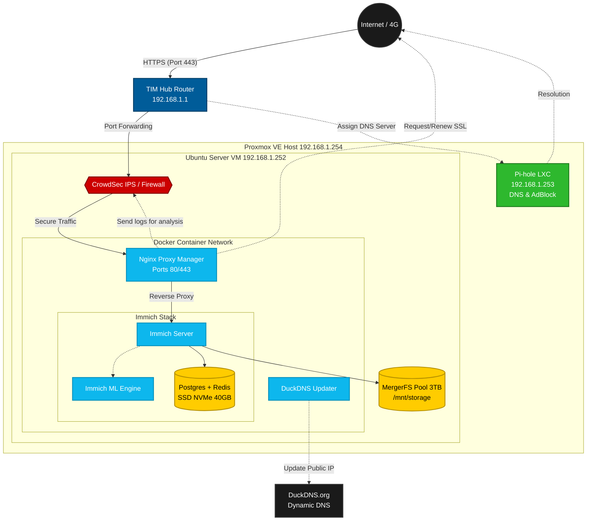

# 🛡️ Personal Homelab & Cybersecurity Infrastructure

An Infrastructure as Code (IaC) repository for my self-hosted home laboratory. Built to replace proprietary cloud services (iCloud) while maintaining strict security controls, reverse proxying, and active intrusion prevention.

## 🏗️ System Architecture

- **Hypervisor:** Proxmox VE 8.2 (Bare-metal on Lenovo IdeaPad)
- **Compute:** Ubuntu Server 24.04 LTS (Isolated VM)
- **Storage:** MergerFS pool pooling multiple USB drives into a single logical volume.
- **Routing & DNS:** Pi-hole (LXC Container) for local DNS resolution and ad-blocking.

## 🔒 Security Posture

Security is a primary focus of this deployment:
1. **Zero Open Ports Internally:** Applications are isolated within Docker networks.
2. **Reverse Proxy:** Nginx Proxy Manager handles all external traffic and enforces HTTPS (Let's Encrypt SSL).
3. **Web Application Firewall (WAF):** CrowdSec is deployed on the host to analyze proxy logs in real-time, detecting and dropping malicious IPs (port scanning, brute-force) at the kernel level (`iptables`).

## 🚀 Deployed Services

### Core
* **Nginx Proxy Manager:** Traffic routing and SSL termination.
* **CrowdSec:** IPS/WAF protecting exposed endpoints.

### Applications
* **Immich:** High-performance, self-hosted photo and video backup (iCloud alternative) utilizing local machine learning for facial recognition.

## 🛠️ Deployment

Each service is defined in its own `docker-compose.yml`. 
To deploy a service:
1. Copy `.env.example` to `.env` and populate secrets.
2. Run `docker compose up -d`.
